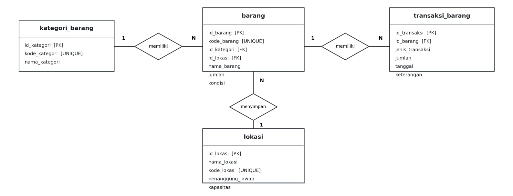

# UTS/UAS PDCS

### Tema: SistemInventari-GerejaKatolik

### Kelompok Anomali

Leonard Kevin Fernando [2511500012] 
Tugas: 
<ul>
    <li>Buat database (scheme.sql)</li>
    <li>Buat ERD</li>
    <li>Menyusun Readme.md</li>
    <li>Menyusun Dokumentasi/ Screenshot</li>
    <li>Membuat config.php</li>
    <li>Membuat thunderclient json</li>
    <li>Menambahkan metode GET,POST,PUT,DELETE di kategori_barang.php</li>
    <li>Menambahkan metode GET,POST,PUT,DELETE di transaksi_barang.php</li>
</ul>
 

Randy [2511500038] 
Tugas: 
<ul>
    <li>Menambahkan metode POST di barang.php</li>
    <li>Mengedit vidio</li>
    <li>Menambahkan metode POST di lokasi.php</li>
    <li>Mengerjakan folder helpers,respone.php</li>
</ul>
 

Melvyn [2511500005] 
Tugas: 
<ul>
    <li>Menambahkan metode PUT di barang.php</li>
    <li>Menambahkan metode PUT di lokasi.php</li>
    <li>Menambahkan metode DELETE di barang.php</li>
</ul>
 

Peter [2511500036] 
Tugas: 
<ul>
    <li>Menambahkan metode GET di barang.php</li>
    <li>Menambahkan metode GET di lokasi.php</li>
    <li>Menambahkan metode DELETE di lokasi.php</li>
</ul>
 

### ERD

### Daftar Endpoint

<table>
  <tr>
    <th>File PHP</th>
    <th>Method</th>
    <th>URL</th>
    <th>Body</th>
    <th>Response</th>
  </tr>

  
<!-- KATEGORI BARANG -->

<tr>
  <td>kategori_barang.php</td>
  <td>GET</td>
  <td>http://localhost/UTS-SistemInventaris-GerejaKatolik/api/kategori_barang.php</td>
  <td>-</td>
  <td><pre>{
  "status": true,
  "message": "berhasil",
  "data": [
    {
      "id_kategori": 6,
      "nama_kategori": "Peralatan Kebersihan Gereja",
      "kode_kategori": "KAT006",
      "deskripsi": "Peralatan untuk menjaga kebersihan gereja",
      "tanggal_dibuat": "2026-11-02"
    },
    {
      "id_kategori": 5,
      "nama_kategori": "Tata laksana",
      "kode_kategori": "KAT005",
      "deskripsi": "Jangan lupa datang hari minggu",
      "tanggal_dibuat": "2026-11-01"
    },
    {
      "id_kategori": 4,
      "nama_kategori": "Perabot Gereja",
      "kode_kategori": "KAT004",
      "deskripsi": "Perabot dan perlengkapan gereja",
      "tanggal_dibuat": "2026-11-01"
    },
    {
      "id_kategori": 3,
      "nama_kategori": "Peralatan Kebersihan",
      "kode_kategori": "KAT003",
      "deskripsi": "Peralatan kebersihan gereja",
      "tanggal_dibuat": "2026-11-01"
    },
    {
      "id_kategori": 2,
      "nama_kategori": "Elektronik",
      "kode_kategori": "KAT002",
      "deskripsi": "Peralatan elektronik gereja",
      "tanggal_dibuat": "2026-11-01"
    },
    {
      "id_kategori": 1,
      "nama_kategori": "Peralatan Elektronik Update",
      "kode_kategori": "KAT001",
      "deskripsi": "Kategori elektronik yang telah diperbarui",
      "tanggal_dibuat": "2026-11-02"
    }
  ]
}</pre></td>
</tr>

<tr>
  <td>kategori_barang.php</td>
  <td>GET</td>
  <td>http://localhost/UTS-SistemInventaris-GerejaKatolik/api/kategori_barang.php?id=999</td>
  <td>-</td>
  <td><pre>{
  "status": false,
  "message": "Kategori tidak ditemukan",
  "data": null
}</pre></td>
</tr>

<tr>
  <td>kategori_barang.php</td>
  <td>GET</td>
  <td>http://localhost/UTS-SistemInventaris-GerejaKatolik/api/kategori_barang.php?id=1</td>
  <td>-</td>
  <td><pre>{
  "status": true,
  "message": "berhasil",
  "data": {
    "id_kategori": 1,
    "nama_kategori": "Peralatan Elektronik Update",
    "kode_kategori": "KAT001",
    "deskripsi": "Kategori elektronik yang telah diperbarui",
    "tanggal_dibuat": "2026-11-02"
  }
}</pre></td>
</tr>

<tr>
  <td>kategori_barang.php</td>
  <td>GET</td>
  <td>http://localhost/UTS-SistemInventaris-GerejaKatolik/api/kategori_barang.php?search=Elektronik</td>
  <td>-</td>
  <td><pre>{
  "status": true,
  "message": "berhasil",
  "data": [
    {
      "id_kategori": 2,
      "nama_kategori": "Elektronik",
      "kode_kategori": "KAT002",
      "deskripsi": "Peralatan elektronik gereja",
      "tanggal_dibuat": "2026-11-01"
    },
    {
      "id_kategori": 1,
      "nama_kategori": "Peralatan Elektronik Update",
      "kode_kategori": "KAT001",
      "deskripsi": "Kategori elektronik yang telah diperbarui",
      "tanggal_dibuat": "2026-11-02"
    }
  ]
}</pre></td>
</tr>

<tr>
  <td>kategori_barang.php</td>
  <td>GET</td>
  <td>http://localhost/UTS-SistemInventaris-GerejaKatolik/api/kategori_barang.php?page=1&amp;limit=2</td>
  <td>-</td>
  <td><pre>{
  "status": true,
  "message": "berhasil",
  "data": [
    {
      "id_kategori": 6,
      "nama_kategori": "Peralatan Kebersihan Gereja",
      "kode_kategori": "KAT006",
      "deskripsi": "Peralatan untuk menjaga kebersihan gereja",
      "tanggal_dibuat": "2026-11-02"
    },
    {
      "id_kategori": 5,
      "nama_kategori": "Tata laksana",
      "kode_kategori": "KAT005",
      "deskripsi": "Jangan lupa datang hari minggu",
      "tanggal_dibuat": "2026-11-01"
    }
  ]
}</pre></td>
</tr>

<tr>
  <td>kategori_barang.php</td>
  <td>POST</td>
  <td>http://localhost/UTS-SistemInventaris-GerejaKatolik/api/kategori_barang.php</td>
  <td><pre>{
  "nama_kategori": "Peralatan Misa",
  "kode_kategori": "KAT007",
  "deskripsi": "Peralatan gereja",
  "tanggal_dibuat": "2026-11-02"
}</pre></td>
  <td><pre>{
  "status": true,
  "message": "kategori berhasil ditambahkan",
  "data": {
    "id": 7
  }
}
</pre></td>
</tr>

<tr>
  <td>kategori_barang.php</td>
  <td>POST</td>
  <td>http://localhost/UTS-SistemInventaris-GerejaKatolik/api/kategori_barang.php</td>
  <td><pre>{
  "nama_kategori": "Kategori Percobaan",
  "kode_kategori": "KAT010"
}</pre></td>
  <td><pre>{
  "status": false,
  "message": "semua field wajib diisi",
  "data": null
}</pre></td>
</tr>

<tr>
  <td>kategori_barang.php</td>
  <td>POST</td>
  <td>http://localhost/UTS-SistemInventaris-GerejaKatolik/api/kategori_barang.php</td>
  <td><pre>{
  "nama_kategori": "Peralatan Liturgi",
  "kode_kategori": "KAT001",
  "deskripsi": "Pengujian kode kategori duplikat",
  "tanggal_dibuat": "2026-11-02"
}</pre></td>
  <td><pre>{
  "status": false,
  "message": "kode kategori sudah digunakan",
  "data": null
}</pre></td>
</tr>

<tr>
  <td>kategori_barang.php</td>
  <td>PUT</td>
  <td>http://localhost/UTS-SistemInventaris-GerejaKatolik/api/kategori_barang.php?id=6</td>
  <td><pre>{
  "nama_kategori": "Peralatan Kebersihan Gereja",
  "kode_kategori": "KAT006",
  "deskripsi": "Peralatan untuk menjaga kebersihan gereja",
  "tanggal_dibuat": "2026-11-02"
}</pre></td>
  <td><pre>{
  "status": true,
  "message": "kategori berhasil di perbarui",
  "data": {
    "id": 6
  }
}</pre></td>
</tr>

<tr>
  <td>kategori_barang.php</td>
  <td>PUT</td>
  <td>http://localhost/UTS-SistemInventaris-GerejaKatolik/api/kategori_barang.php?id=5</td>
  <td><pre>{
  "nama_kategori": "Kategori Percobaan",
  "kode_kategori": "KAT999"
}</pre></td>
  <td><pre>{
  "status": false,
  "message": "semua field wajib diisi",
  "data": null
}</pre></td>
</tr>

<tr>
  <td>kategori_barang.php</td>
  <td>PUT</td>
  <td>http://localhost/UTS-SistemInventaris-GerejaKatolik/api/kategori_barang.php?id=9</td>
  <td><pre>{
  "nama_kategori": "Kategori Percobaan",
  "kode_kategori": "KAT999",
  "deskripsi": "Pengujian kategori yang tidak ditemukan",
  "tanggal_dibuat": "2026-11-02"
}</pre></td>
  <td><pre>{
  "status": false,
  "message": "kategori tidak ditemukan",
  "data": null
}</pre></td>
</tr>

<tr>
  <td>kategori_barang.php</td>
  <td>DELETE</td>
  <td>http://localhost/UTS-SistemInventaris-GerejaKatolik/api/kategori_barang.php?id=7</td>
  <td>-</td>
  <td><pre>{
  "status": true,
  "message": "kategori berhasil dihapus",
  "data": {
    "id": 7
  }
}</pre></td>
</tr>

<tr>
  <td>kategori_barang.php</td>
  <td>DELETE</td>
  <td>http://localhost/UTS-SistemInventaris-GerejaKatolik/api/kategori_barang.php?id=999</td>
  <td>-</td>
  <td><pre>{
  "status": false,
  "message": "kategori tidak  ditemukan",
  "data": null
}</pre></td>
</tr>

  
<!-- BARANG -->
<tr>
  <td>barang.php</td>
  <td>GET</td>
  <td>http://localhost/UTS-SistemInventaris-GerejaKatolik/api/barang.php</td>
  <td>-</td>
  <td><pre>{
  "status": true,
  "message": "berhasil",
  "data": [
    {
      "id_barang": 8,
      "kode_barang": "BRG008",
      "id_kategori": 1,
      "id_lokasi": 1,
      "nama_barang": "Mikrofon Gereja",
      "jumlah": 5,
      "kondisi": "Baik",
      "nama_kategori": "Peralatan Elektronik Update",
      "nama_lokasi": "Sakristi"
    },
    {
      "id_barang": 7,
      "kode_barang": "BRG007",
      "id_kategori": 5,
      "id_lokasi": 6,
      "nama_barang": "Kursi Altar",
      "jumlah": 4,
      "kondisi": "Kurang Baik",
      "nama_kategori": "Tata laksana",
      "nama_lokasi": "Gudang Serbaguna"
    },
    {
      "id_barang": 6,
      "kode_barang": "BRG006",
      "id_kategori": 4,
      "id_lokasi": 3,
      "nama_barang": "Kursi Plastik",
      "jumlah": 100,
      "kondisi": "Baik",
      "nama_kategori": "Perabot Gereja",
      "nama_lokasi": "Aula Gereja"
    },
    {
      "id_barang": 5,
      "kode_barang": "BRG005",
      "id_kategori": 3,
      "id_lokasi": 4,
      "nama_barang": "Sapu Lantai",
      "jumlah": 10,
      "kondisi": "Baik",
      "nama_kategori": "Peralatan Kebersihan",
      "nama_lokasi": "Gudang Gereja"
    },
    {
      "id_barang": 4,
      "kode_barang": "BRG004",
      "id_kategori": 2,
      "id_lokasi": 2,
      "nama_barang": "Laptop",
      "jumlah": 2,
      "kondisi": "Baik",
      "nama_kategori": "Elektronik",
      "nama_lokasi": "Ruang Sekretariat"
    },
    {
      "id_barang": 3,
      "kode_barang": "BRG003",
      "id_kategori": 2,
      "id_lokasi": 3,
      "nama_barang": "Speaker Aktif",
      "jumlah": 4,
      "kondisi": "Baik",
      "nama_kategori": "Elektronik",
      "nama_lokasi": "Aula Gereja"
    },
    {
      "id_barang": 2,
      "kode_barang": "BRG002",
      "id_kategori": 1,
      "id_lokasi": 1,
      "nama_barang": "Sibori",
      "jumlah": 3,
      "kondisi": "Baik",
      "nama_kategori": "Peralatan Elektronik Update",
      "nama_lokasi": "Sakristi"
    },
    {
      "id_barang": 1,
      "kode_barang": "BRG001",
      "id_kategori": 1,
      "id_lokasi": 1,
      "nama_barang": "Piala Misa",
      "jumlah": 5,
      "kondisi": "Baik",
      "nama_kategori": "Peralatan Elektronik Update",
      "nama_lokasi": "Sakristi"
    }
  ]
}</pre></td>
</tr>
<tr>
  <td>barang.php</td>
  <td>GET</td>
  <td>http://localhost/UTS-SistemInventaris-GerejaKatolik/api/barang.php?id=999</td>
  <td>-</td>
  <td><pre>{
  "status": false,
  "message": "Barang tidak ditemukan",
  "data": null
}</pre></td>
</tr>
<tr>
  <td>barang.php</td>
  <td>GET</td>
  <td>http://localhost/UTS-SistemInventaris-GerejaKatolik/api/barang.php?id=2</td>
  <td>-</td>
  <td><pre>{
  "status": true,
  "message": "berhasil",
  "data": {
    "id_barang": 2,
    "kode_barang": "BRG002",
    "id_kategori": 1,
    "id_lokasi": 1,
    "nama_barang": "Sibori",
    "jumlah": 3,
    "kondisi": "Baik",
    "nama_kategori": "Peralatan Elektronik Update",
    "nama_lokasi": "Sakristi"
  }
}</pre></td>
</tr>
<tr>
  <td>barang.php</td>
  <td>GET</td>
  <td>http://localhost/UTS-SistemInventaris-GerejaKatolik/api/barang.php?search=piala</td>
  <td>-</td>
  <td><pre>{
  "status": true,
  "message": "berhasil",
  "data": [
    {
      "id_barang": 1,
      "kode_barang": "BRG001",
      "id_kategori": 1,
      "id_lokasi": 1,
      "nama_barang": "Piala Misa",
      "jumlah": 5,
      "kondisi": "Baik",
      "nama_kategori": "Peralatan Elektronik Update",
      "nama_lokasi": "Sakristi"
    }
  ]
}</pre></td>
</tr>
<tr>
  <td>barang.php</td>
  <td>GET</td>
  <td>http://localhost/UTS-SistemInventaris-GerejaKatolik/api/barang.php?page=1&amp;limit=2</td>
  <td>-</td>
  <td><pre>{
  "status": true,
  "message": "berhasil",
  "data": [
    {
      "id_barang": 8,
      "kode_barang": "BRG008",
      "id_kategori": 1,
      "id_lokasi": 1,
      "nama_barang": "Mikrofon Gereja",
      "jumlah": 5,
      "kondisi": "Baik",
      "nama_kategori": "Peralatan Elektronik Update",
      "nama_lokasi": "Sakristi"
    },
    {
      "id_barang": 7,
      "kode_barang": "BRG007",
      "id_kategori": 5,
      "id_lokasi": 6,
      "nama_barang": "Kursi Altar",
      "jumlah": 4,
      "kondisi": "Kurang Baik",
      "nama_kategori": "Tata laksana",
      "nama_lokasi": "Gudang Serbaguna"
    }
  ]
}</pre></td>
</tr>
<tr>
  <td>barang.php</td>
  <td>POST</td>
  <td>http://localhost/UTS-SistemInventaris-GerejaKatolik/api/barang.php</td>
  <td><pre>{
  "kode_barang": "BRG008",
  "id_kategori": 1,
  "id_lokasi": 1,
  "nama_barang": "Mikrofon Gereja",
  "jumlah": 5,
  "kondisi": "Baik"
}</pre></td>
  <td><pre>{
  "status": true,
  "message": "barang berhasil ditambahkan",
  "data": {
    "id": 8
  }
}</pre></td>
</tr>
<tr>
  <td>barang.php</td>
  <td>POST</td>
  <td>http://localhost/UTS-SistemInventaris-GerejaKatolik/api/barang.php</td>
  <td><pre>{
  "kode_barang": "BRG011",
  "id_kategori": 1,
  "id_lokasi": 1,
  "jumlah": 5,
  "kondisi": "Baik"
}</pre></td>
  <td><pre>{
  "status": false,
  "message": "semua field wajib diisi",
  "data": null
}</pre></td>
</tr>
<tr>
  <td>barang.php</td>
  <td>POST</td>
  <td>http://localhost/UTS-SistemInventaris-GerejaKatolik/api/barang.php</td>
  <td><pre>{
  "kode_barang": "BRG012",
  "id_kategori": 999,
  "id_lokasi": 1,
  "nama_barang": "Mikrofon Gereja",
  "jumlah": 5,
  "kondisi": "Baik"
}</pre></td>
  <td><pre>{
  "status": false,
  "message": "kategori tidak ditemukan",
  "data": null
}</pre></td>
</tr>
<tr>
  <td>barang.php</td>
  <td>POST</td>
  <td>http://localhost/UTS-SistemInventaris-GerejaKatolik/api/barang.php</td>
  <td><pre>{
  "kode_barang": "BRG013",
  "id_kategori": 1,
  "id_lokasi": 999,
  "nama_barang": "Mikrofon Gereja",
  "jumlah": 5,
  "kondisi": "Baik"
}</pre></td>
  <td><pre>{
  "status": false,
  "message": "lokasi tidak ditemukan",
  "data": null
}</pre></td>
</tr>
<tr>
  <td>barang.php</td>
  <td>POST</td>
  <td>http://localhost/UTS-SistemInventaris-GerejaKatolik/api/barang.php</td>
  <td><pre>{
  "kode_barang": "BRG09",
  "id_kategori": 1,
  "id_lokasi": 1,
  "nama_barang": "Speaker Gereja",
  "jumlah": 3,
  "kondisi": "Baik"
}</pre></td>
  <td><pre>{
  "status": false,
  "message": "Kode barang sudah digunakan",
  "data": null
}</pre></td>
</tr>
<tr>
  <td>barang.php</td>
  <td>PUT</td>
  <td>http://localhost/UTS-SistemInventaris-GerejaKatolik/api/barang.php?id=9</td>
  <td><pre>{
  "kode_barang": "BRG009",
  "id_kategori": 1,
  "id_lokasi": 1,
  "nama_barang": "speaker Gereja Update",
  "jumlah": 10,
  "kondisi": "Baik"
}</pre></td>
  <td><pre>{
  "status": true,
  "message": "barang berhasil diperbaharui",
  "data": {
    "id": 9
  }
}</pre></td>
</tr>
<tr>
  <td>barang.php</td>
  <td>PUT</td>
  <td>http://localhost/UTS-SistemInventaris-GerejaKatolik/api/barang.php?id=9</td>
  <td><pre>{
  "id_kategori": 1,
  "id_lokasi": 1,
  "nama_barang": "speaker Gereja Update",
  "jumlah": 10,
  "kondisi": "Baik"
}</pre></td>
  <td><pre>{
  "status": false,
  "message": "semua field wajib diisi",
  "data": null
}</pre></td>
</tr>
<tr>
  <td>barang.php</td>
  <td>PUT</td>
  <td>http://localhost/UTS-SistemInventaris-GerejaKatolik/api/barang.php?id=99</td>
  <td><pre>{
  "kode_barang": "BRG009",
  "id_kategori": 1,
  "id_lokasi": 1,
  "nama_barang": "speaker Gereja Update",
  "jumlah": 10,
  "kondisi": "Baik"
}</pre></td>
  <td><pre>{
  "status": false,
  "message": "barang tidak ditemukan",
  "data": null
}</pre></td>
</tr>
<tr>
  <td>barang.php</td>
  <td>DELETE</td>
  <td>http://localhost/UTS-SistemInventaris-GerejaKatolik/api/barang.php?id=9</td>
  <td>-</td>
  <td><pre>{
  "status": true,
  "message": "barang berhasil dihapus",
  "data": {
    "id": 9
  }
}</pre></td>
</tr>
<tr>
  <td>barang.php</td>
  <td>DELETE</td>
  <td>http://localhost/UTS-SistemInventaris-GerejaKatolik/api/barang.php?id=99</td>
  <td>-</td>
  <td><pre>{
  "status": false,
  "message": "barang tidak ditemukan",
  "data": null
}</pre></td>
</tr>

  <!-- LOKASI -->
  <tr>
    <td>lokasi.php</td>
    <td>GET</td>
    <td>http://localhost/UTS-SistemInventaris-GerejaKatolik/api/lokasi.php</td>
    <td>-</td>
    <td>{
  "status": true,
  "message": "berhasil",
  "data": [
    {
      "id_lokasi": 6,
      "nama_lokasi": "Gudang Serbaguna",
      "kode_lokasi": "LOK006",
      "penanggung_jawab": "Petugas Gudang Baru",
      "kapasitas": 2000
    },
    {
      "id_lokasi": 5,
      "nama_lokasi": "Gudang Gereja 2",
      "kode_lokasi": "LOK005",
      "penanggung_jawab": "Petugas Gudang Baru",
      "kapasitas": 2000
    },
    {
      "id_lokasi": 4,
      "nama_lokasi": "Gudang Gereja",
      "kode_lokasi": "LOK004",
      "penanggung_jawab": "Petugas Gudang",
      "kapasitas": 200
    },
    {
      "id_lokasi": 3,
      "nama_lokasi": "Aula Gereja",
      "kode_lokasi": "LOK003",
      "penanggung_jawab": "Petugas Aula",
      "kapasitas": 150
    },
    {
      "id_lokasi": 2,
      "nama_lokasi": "Ruang Sekretariat",
      "kode_lokasi": "LOK002",
      "penanggung_jawab": "Sekretaris Gereja",
      "kapasitas": 30
    },
    {
      "id_lokasi": 1,
      "nama_lokasi": "Sakristi",
      "kode_lokasi": "LOK001",
      "penanggung_jawab": "Petugas Sakristi",
      "kapasitas": 50
    }
  ]
}
</td>
  </tr>
  <tr>
    <td>lokasi.php</td>
    <td>GET</td>
    <td>http://localhost/UTS-SistemInventaris-GerejaKatolik/api/lokasi.php?id=99</td>
    <td>-</td>
    <td>{
  "status": false,
  "message": "Lokasi tidak ditemukan",
  "data": null
}
</td>
  </tr>
  <tr>
    <td>lokasi.php</td>
    <td>GET</td>
    <td>http://localhost/UTS-SistemInventaris-GerejaKatolik/api/lokasi.php?id=2</td>
    <td>-</td>
    <td>{
  "status": false,
  "message": "Lokasi tidak ditemukan",
  "data": null 
}
</td>
  </tr>
  <tr>
    <td>lokasi.php</td>
    <td>GET</td>
    <td>http://localhost/UTS-SistemInventaris-GerejaKatolik/api/lokasi.php?search=sak</td>
    <td>-</td>
    <td>{
  "status": true,
  "message": "berhasil",
  "data": [
    {
      "id_lokasi": 1,
      "nama_lokasi": "Sakristi",
      "kode_lokasi": "LOK001",
      "penanggung_jawab": "Petugas Sakristi",
      "kapasitas": 50
    }
  ]
}
</td>
  </tr>
  <tr>
    <td>lokasi.php</td>
    <td>GET</td>
    <td>http://localhost/UTS-SistemInventaris-GerejaKatolik/api/lokasi.php?page=1&limit=2</td>
    <td>-</td>
    <td>{
  "status": true,
  "message": "berhasil",
  "data": [
    {
      "id_lokasi": 6,
      "nama_lokasi": "Gudang Serbaguna",
      "kode_lokasi": "LOK006",
      "penanggung_jawab": "Petugas Gudang Baru",
      "kapasitas": 2000
    },
    {
      "id_lokasi": 5,
      "nama_lokasi": "Gudang Gereja 2",
      "kode_lokasi": "LOK005",
      "penanggung_jawab": "Petugas Gudang Baru",
      "kapasitas": 2000
    }
  ]
}
</td>
  </tr>
  <tr>
    <td>lokasi.php</td>
    <td>POST</td>
    <td>http://localhost/UTS-SistemInventaris-GerejaKatolik/api/lokasi.php</td>
    <td><pre>{
  "nama_lokasi": "Aula Paroki",
  "kode_lokasi": "LOK007",
  "penanggung_jawab": "Petugas Liturgi",
  "kapasitas": 200
}</pre></td>
    <td>201 Created - Data lokasi berhasil ditambahkan</td>
  </tr>
  <tr>
    <td>lokasi.php</td>
    <td>POST</td>
    <td>http://localhost/UTS-SistemInventaris-GerejaKatolik/api/lokasi.php</td>
    <td><pre>{
  "nama_lokasi": "Aula Paroki",
  "kode_lokasi": "LOK007"
}</pre></td>
    <td>400 Bad Request - Data lokasi tidak lengkap</td>
  </tr>
  <tr>
    <td>lokasi.php</td>
    <td>POST</td>
    <td>http://localhost/UTS-SistemInventaris-GerejaKatolik/api/lokasi.php</td>
    <td><pre>{
  "nama_lokasi": "Aula Paroki",
  "kode_lokasi": "LOK007",
  "penanggung_jawab": "Petugas Liturgi",
  "kapasitas": 200
}</pre></td>
    <td>409 Conflict - Kode lokasi sudah digunakan</td>
  </tr>
  <tr>
    <td>lokasi.php</td>
    <td>PUT</td>
    <td>http://localhost/UTS-SistemInventaris-GerejaKatolik/api/lokasi.php?id=7</td>
    <td><pre>{
  "nama_lokasi": "Aula 1",
  "kode_lokasi": "LOK007",
  "penanggung_jawab": "Petugas Liturgi",
  "kapasitas": 200
}</pre></td>
    <td>200 OK - Data lokasi berhasil diperbarui</td>
  </tr>
  <tr>
    <td>lokasi.php</td>
    <td>PUT</td>
    <td>http://localhost/UTS-SistemInventaris-GerejaKatolik/api/lokasi.php?id=7</td>
    <td><pre>{
  "nama_lokasi": "Aula 1",
  "kode_lokasi": "LOK007"
}</pre></td>
    <td>400 Bad Request - Data lokasi tidak lengkap</td>
  </tr>
  <tr>
    <td>lokasi.php</td>
    <td>PUT</td>
    <td>http://localhost/UTS-SistemInventaris-GerejaKatolik/api/lokasi.php?id=777</td>
    <td><pre>{
  "nama_lokasi": "Aula Paroki",
  "kode_lokasi": "LOK777",
  "penanggung_jawab": "Petugas Liturgi",
  "kapasitas": 200
}</pre></td>
    <td>404 Not Found - Lokasi tidak ditemukan</td>
  </tr>
  <tr>
    <td>lokasi.php</td>
    <td>DELETE</td>
    <td>http://localhost/UTS-SistemInventaris-GerejaKatolik/api/lokasi.php?id=7</td>
    <td>-</td>
    <td>200 OK - Data lokasi berhasil dihapus</td>
  </tr>
  <tr>
    <td>lokasi.php</td>
    <td>DELETE</td>
    <td>http://localhost/UTS-SistemInventaris-GerejaKatolik/api/lokasi.php?id=77</td>
    <td>-</td>
    <td>404 Not Found - Lokasi tidak ditemukan</td>
  </tr>

  <!-- TRANSAKSI BARANG -->
  <tr>
    <td>transaksi_barang.php</td>
    <td>GET</td>
    <td>http://localhost/UTS-SistemInventaris-GerejaKatolik/api/transaksi_barang.php</td>
    <td>-</td>
    <td>200 OK - Berhasil mengambil semua data transaksi barang</td>
  </tr>
  <tr>
    <td>transaksi_barang.php</td>
    <td>GET</td>
    <td>http://localhost/UTS-SistemInventaris-GerejaKatolik/api/transaksi_barang.php?id=999</td>
    <td>-</td>
    <td>404 Not Found - Transaksi barang tidak ditemukan</td>
  </tr>
  <tr>
    <td>transaksi_barang.php</td>
    <td>GET</td>
    <td>http://localhost/UTS-SistemInventaris-GerejaKatolik/api/transaksi_barang.php?page=1&limit=2</td>
    <td>-</td>
    <td>200 OK - Berhasil menampilkan pagination transaksi barang</td>
  </tr>
  <tr>
    <td>transaksi_barang.php</td>
    <td>POST</td>
    <td>http://localhost/UTS-SistemInventaris-GerejaKatolik/api/transaksi_barang.php</td>
    <td><pre>{
  "id_barang": 7,
  "jenis_transaksi": "Masuk",
  "jumlah": 10,
  "tanggal": "2026-10-08",
  "keterangan": "Pemindahan Meja"
}</pre></td>
    <td>201 Created - Data transaksi berhasil ditambahkan</td>
  </tr>
  <tr>
    <td>transaksi_barang.php</td>
    <td>POST</td>
    <td>http://localhost/UTS-SistemInventaris-GerejaKatolik/api/transaksi_barang.php</td>
    <td><pre>{
  "id_barang": 7,
  "jenis_transaksi": "Masuk",
  "jumlah": 10
}</pre></td>
    <td>400 Bad Request - Semua field wajib diisi</td>
  </tr>
  <tr>
    <td>transaksi_barang.php</td>
    <td>POST</td>
    <td>http://localhost/UTS-SistemInventaris-GerejaKatolik/api/transaksi_barang.php</td>
    <td><pre>{
  "id_barang": 9999,
  "jenis_transaksi": "Masuk",
  "jumlah": 10,
  "tanggal": "2026-10-08",
  "keterangan": "Pengujian FK 404"
}</pre></td>
    <td>404 Not Found - Barang tidak ditemukan</td>
  </tr>
  <tr>
    <td>transaksi_barang.php</td>
    <td>PUT</td>
    <td>http://localhost/UTS-SistemInventaris-GerejaKatolik/api/transaksi_barang.php?id=6</td>
    <td><pre>{
  "id_barang": 7,
  "jenis_transaksi": "Keluar",
  "jumlah": 10,
  "tanggal": "2026-10-08",
  "keterangan": "Pemindahan Meja"
}</pre></td>
    <td>200 OK - Data transaksi berhasil diperbarui</td>
  </tr>
  <tr>
    <td>transaksi_barang.php</td>
    <td>PUT</td>
    <td>http://localhost/UTS-SistemInventaris-GerejaKatolik/api/transaksi_barang.php?id=6</td>
    <td><pre>{
  "id_barang": 77,
  "jenis_transaksi": "Keluar",
  "jumlah": 10,
  "tanggal": "2026-10-08",
  "keterangan": "Pemindahan Meja"
}</pre></td>
    <td>404 Not Found - Barang tidak ditemukan</td>
  </tr>
  <tr>
    <td>transaksi_barang.php</td>
    <td>DELETE</td>
    <td>http://localhost/UTS-SistemInventaris-GerejaKatolik/api/transaksi_barang.php?id=6</td>
    <td>-</td>
    <td>200 OK - Data transaksi berhasil dihapus</td>
  </tr>
</table>

<h2>Deskripsi Proyek</h2>

  Sistem ini dirancang untuk mengelola data inventaris barang gereja, mulai dari pengelompokan barang berdasarkan kategori, pencatatan lokasi penyimpanan, hingga pencatatan transaksi barang masuk dan keluar. Dengan sistem ini, pengelolaan inventaris menjadi lebih terstruktur dan mudah dipantau.

  Hubungan relasi antar tabel
  1. kategori_barang – barang (1:N)
  Satu kategori dapat memiliki banyak barang, sedangkan satu barang hanya memiliki satu kategori. Contohnya, kategori Peralatan Liturgi dapat memiliki barang seperti piala misa dan perlengkapan misa lainnya.
  2. lokasi – barang (1:N)
  Satu lokasi dapat menyimpan banyak barang, sedangkan satu barang ditempatkan pada satu lokasi. Contohnya, Gudang Gereja dapat menyimpan kursi, sapu, dan perlengkapan lainnya.
  3. barang – transaksi_barang (1:N)
  Satu barang dapat memiliki banyak transaksi, sedangkan satu transaksi hanya mencatat satu jenis barang. Contohnya, barang laptop dapat memiliki riwayat transaksi barang masuk maupun barang keluar.

  Dengan adanya sistem ini, pengelolaan inventaris diharapkan menjadi lebih terstruktur, mempermudah pencatatan data, dan membantu pemantauan barang yang dimiliki gereja.

### 3 Cara Menjalankan

1. Import Schema Database

<ol>
    <li>Buka Laragon, kemudian klik Start All</li>
    <li>Buka browser dan akses http://localhost/phpmyadmin</li>
    <li>Pilih database yang akan digunakan atau buat database baru</li>
    <li>Pilih menu Import</li>
    <li>Klik Choose File, lalu pilih file database (file yang berekstensi .sql)</li>
    <li>Klik tombol Import</li>
    <li>Periksa apakah tabel barang, kategori_barang, lokasi, transaksi_barang berhasil diimpor</li>
</ol>

2. Menjalankan Project Menggunakan Laragon

<ol>
    <li>Buka aplikasi Laragon</li>
    <li>Klik Start All untuk menjalankan Apache dan MySQL</li>
    <li>Pastikan folder project berada di dalam direktori C:\laragon\www (C: bisa sesuai dengan lokasi laragon masing-masing)</li>
    <li>Pastikan konfigurasi database pada file config.php sudah sesuai dengan database di PhpMyAdmin</li>
    <li>
        Buka browser dan akses alamat project: http://localhost/UTS-SistemInventaris-GerejaKatolik/api/barang.php
    </li>
</ol>

3. Pengujian API Menggunakan Thunder Client

<ol>
    <li>Buka Visual Studio Code</li>
    <li>Klik ikon Thunder Client pada sidebar (instal dari menu Extension jika belum terinstal)</li>
    <li>Pilih New Request</li>
    <li>Pilih metode HTTP sesuai endpoint yang akan diuji (GET, POST, PUT, atau DELETE)</li>
    <li>Masukkan URL endpoint yang ingin diuji (contohnya dapat dilihat pada tabel daftar endpoint)</li>
    <li>Untuk metode POST dan PUT, pilih Body dan pilih JSON</li>
    <li>Masukkan data JSON sesuai kebutuhan (contohnya dapat dilihat pada tabel daftar endpoint)</li>
    <li>Klik Send untuk mengirim request</li>
    <li>Periksa hasil pengujian pada bagian Response</li>
</ol>